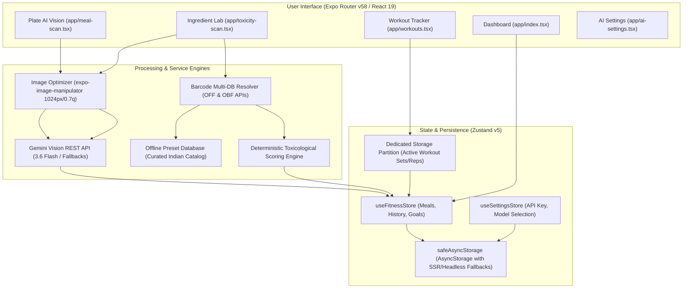
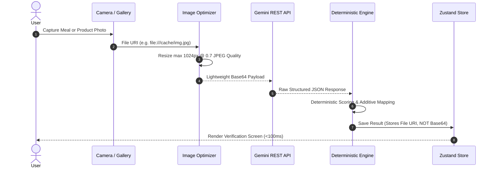

# BetterYou 🥗🏋️‍♂️🔬

**BetterYou** is an intelligent mobile application combining **AI-driven plate computer vision**, **forensic toxicological ingredient scanning**, and **comprehensive strength & workout tracking**. Built on **Expo SDK 58**, **React Native 0.88**, and **React 19**, BetterYou runs entirely offline-first with local storage persistence and optional multimodal grounding via the **Google Gemini API**.

---

## Table of Contents

1. [Architectural Overview](#architectural-overview)
2. [Core Modules & How They Work](#core-modules--how-they-work)
   - [Plate AI Vision (Nutrition & Macro Tracking)](#1-plate-ai-vision-nutrition--macro-tracking)
   - [Ingredient Lab (Toxicological & Barcode Inspection)](#2-ingredient-lab-toxicological--barcode-inspection)
   - [Strength & Workout Tracking Engine](#3-strength--workout-tracking-engine)
   - [Interactive Dashboard & Calendar](#4-interactive-dashboard--calendar)
   - [AI Settings & Live Diagnostics](#5-ai-settings--live-diagnostics)
3. [Under the Hood: Technical Architecture](#under-the-hood-technical-architecture)
   - [Multimodal Vision Pipeline & Optimization](#multimodal-vision-pipeline--optimization)
   - [Multi-Tiered Toxicological Scoring Engine](#multi-tiered-toxicological-scoring-engine)
   - [High-Frequency Workout State Partitioning](#high-frequency-workout-state-partitioning)
   - [Timezone-Safe Streak & Date Utilities](#timezone-safe-streak--date-utilities)
4. [Project Directory Structure](#project-directory-structure)
5. [Getting Started](#getting-started)
   - [Prerequisites](#prerequisites)
   - [Installation](#installation)
   - [Environment Configuration](#environment-configuration)
   - [Running the App](#running-the-app)
   - [Testing & Quality Assurance](#testing--quality-assurance)
6. [Supported Gemini Models](#supported-gemini-models)
7. [Privacy & Security](#privacy--security)

---

## Architectural Overview



---

## Core Modules & How They Work

### 1. Plate AI Vision (Nutrition & Macro Tracking)
*Route: `src/app/(tabs)/meal-scan.tsx`*

Plate AI Vision turns meal photos into structured macronutrient breakdowns in seconds:

1. **Capture & Preprocessing**:
   - The user frames their meal using the interactive camera viewfinder (`expo-camera`) with live reticle, torch toggle, and front/rear lens switching. Alternatively, photos can be imported from the device gallery (`expo-image-picker`).
   - Before transmission, images are dynamically resized to a maximum dimension of 1024px at 70% JPEG quality using `expo-image-manipulator`. This produces an ephemeral lightweight base64 payload while keeping the app responsive.
2. **Multimodal Inference**:
   - The payload is dispatched to the Gemini Vision REST endpoint with a structured system prompt.
   - The model analyzes the meal and responds with a strict JSON payload containing:
     - `dishName`: Concise descriptive title.
     - `estimatedWeightGrams`: Total portion weight in grams.
     - `calories`: Total energy in kcal.
     - `protein`, `carbs`, `fat`: Macro breakdown in grams.
     - `confidenceScore`: Float between 0.1 and 1.0.
     - `ingredientsDetected`: Array of detected food components.
3. **Interactive Verification & Adjustment**:
   - Users inspect the scan on a verification screen displaying detected ingredients, calorie chips, and macro ratios.
   - **Portion Multipliers**: Quick presets (`0.5x`, `0.75x`, `1.0x`, `1.25x`, `1.5x`, `2.0x`) scale calories and macros proportionally in real time.
   - **Manual Correction**: Users can edit the dish name or override macro estimates directly.
   - **Meal Category Assignment**: Tag meals as *Breakfast*, *Lunch*, *Dinner*, or *Snack* before saving.
4. **Natural Language / Manual Fallback**:
   - Users can tap "Type Meal" to open `ManualMealModal`. Entering natural language descriptions (e.g., *"3 scrambled eggs with brown bread and black coffee"*) calculates nutritional macros via Gemini text parsing or offline heuristic fallback.

---

### 2. Ingredient Lab (Toxicological & Barcode Inspection)
*Route: `src/app/(tabs)/toxicity-scan.tsx`*

The Ingredient Lab provides forensic toxicological screening for packaged foods, personal care products, and household items, specifically tuned for the **Indian consumer market**:

1. **Barcode Scanning & Fast-Path Lookup**:
   - Scans EAN/UPC barcodes using `CameraView` with automatic throttling and audio-haptic feedback.
   - **Instant Offline Presets (<1ms)**: Matches barcodes against a built-in catalog of staple Indian products (e.g., *Kurkure Masala Munch*, *Maggi 2-Minute Noodles*, *Haldiram's Aloo Bhujia*, *Glow & Lovely*, *Dettol Soap*, *Colgate Strong Teeth*, *Good Knight Liquid Vaporizer*, *Lizol Cleaner*, *Johnson's Baby Powder*, *Cold-Pressed Mustard Oil*).
   - **Dual Remote DB Query**: Barcodes not found locally are queried simultaneously against **OpenFoodFacts** and **OpenBeautyFacts** via sparse field filtering (`?fields=product_name,ingredients_text,additives_tags,nova_group,nutriscore_grade`) to minimize bandwidth consumption (~2KB vs. ~80KB).
   - **Negative Cache**: Failed lookups are cached for 5 minutes to prevent network polling loops on unregistered barcodes.
2. **AI Label OCR & Multimodal Analysis**:
   - For products without barcodes or with unlisted ingredients, users snap a photo of the ingredients panel.
   - Gemini Vision performs optical character recognition (OCR) across complex Indian packaging formats.
   - Results are cross-referenced with our deterministic toxicological rule set to ensure that scores remain mathematically grounded rather than subject to generative hallucination.
   - An in-memory fingerprint cache (`name:::sorted_ingredients`) guarantees instantaneous and identical output on duplicate scans.
3. **Supermarket Category Classification**:
   Automatically categorizes products into one of 8 regulatory scopes:
   - **Food & Beverages** (*FSSAI* standard, *Ingestion* exposure)
   - **Personal Care & Skincare** (*CDSCO* standard, *Dermal Absorption* exposure)
   - **Hair Care** (*CDSCO* standard, *Dermal Absorption* exposure)
   - **Oral Care** (*CDSCO* standard, *Mucous Membrane* exposure)
   - **Household & Cleaning** (*BIS* standard, *General* exposure)
   - **Pest Control** (*CIBRC* standard, *Inhalation* exposure)
   - **Baby Care** (*CDSCO* standard, *Dermal Absorption* exposure)
   - **Ayurveda & OTC** (*AYUSH* standard, *Ingestion* exposure)
4. **Context-Aware Indian Market Alerts**:
   Flags common commercial traps and deceptive labeling:
   - **Hair Oil Trap**: Identifies formulations containing 75–85% Light Liquid Paraffin (mineral oil) marketed as herbal/almond oil.
   - **Pest Control Indoor Air Warning**: Flags synthetic pyrethroids (Transfluthrin/Prallethrin) in vaporizers that cause airway irritation in enclosed bedrooms.
   - **Oral Mucosa Alert**: Flags Sodium Lauryl Sulfate (SLS) in toothpastes known to trigger canker sores.
   - **Floor Cleaner Hazard**: Identifies Benzalkonium Chloride (BKC/Quats) that pose toxic risks to crawling toddlers and pets.
   - **Pediatric Safety Alert**: Exposes talc-based powders posing pulmonary inhalation risks for infants.
   - **Ayurvedic Preservative Alert**: Highlights synthetic methylparaben and high sucrose content in herbal tonics.
5. **Interactive Ingredient Editing**:
   - Users can open `EditProductModal` to inspect the detected ingredient list, delete items, or add new ingredients. The safety score, risk level, and certification tags automatically recompute upon modification.

---

### 3. Strength & Workout Tracking Engine
*Route: `src/app/(tabs)/workouts.tsx`*

Built for serious weightlifters and everyday gym enthusiasts:

1. **Session Lifecycle**:
   - Start workouts using predefined templates (*Push Day*, *Pull Day*, *Leg Day*) or create custom routines.
   - Add exercises from a catalog of popular compound and isolation movements, or input custom exercise names.
2. **Set Logging**:
   - Track **Weight (kg)** and **Reps** per set.
   - Check off completed sets with immediate haptic feedback.
   - Quick "Add Set" button duplicates the weight and reps from the previous set for seamless logging.
3. **Floating Auto-Rest Timer**:
   - Completing a set automatically initiates the countdown timer.
   - Quick-select duration presets: **60s**, **90s**, and **120s**.
   - Features a floating status bar with time remaining, `+30s` extension, and skip controls.
   - Plays haptic patterns upon timer expiration.
4. **Total Volume Calculation**:
   - Live volume summation:
     $$\text{Total Volume (kg)} = \sum (\text{Weight} \times \text{Reps})$$
   - Only completed sets are factored into volume calculations.
5. **Streak Tracking**:
   - Tracks workout streaks across consecutive calendar days using local midnight boundaries to prevent timezone slippage.

---

### 4. Interactive Dashboard & Calendar
*Route: `src/app/(tabs)/index.tsx`*

The central hub aggregating daily health metrics:

- **7-Day Rolling Calendar Strip**: Tap any recent date to review historic nutrition logs and workout volume.
- **Calorie & Macro Ring**: Compares consumed calories and macros (Protein, Carbs, Fat) against user-defined goals.
- **Workout Highlights**: Displays daily volume lifted, exercises logged, and estimated active calories burned.
- **Recent Scans Drawer**: Quick-access carousel for inspected supermarket items. Tapping any item opens the full `ToxicityReportModal`.
- **Active Workout Banner**: When a workout is in progress, a persistent banner provides one-tap navigation back to the active session.

---

### 5. AI Settings & Live Diagnostics
*Routes: `src/app/ai-settings.tsx` and `src/app/diagnostics.tsx`*

Enables total user control over the AI engine:

- **Custom API Key Support**: Users can enter their own Google Gemini API key or fall back to the environment default (`EXPO_PUBLIC_GEMINI_API_KEY`). Keys are stored locally in secure storage and masked on screen.
- **Model Selector**: Switch between recommended Gemini models or supply a custom model ID.
- **Model Spec Cards**: Review latency ratings, multimodal accuracy scores, context limits, and free-tier daily quotas for each model.
- **Live Diagnostics Tool**: Run real-time ping tests against Google's API to verify network connectivity, API key authorization, and round-trip latency in milliseconds.

---

## Under the Hood: Technical Architecture

### Multimodal Vision Pipeline & Optimization

Passing full-resolution camera captures into remote LLMs causes memory bottlenecks and mobile payload failures. BetterYou implements a multi-step vision pipeline:



> [!IMPORTANT]
> **Zero CursorWindow Bloat**: Persistent storage saves only local filesystem URIs (`file://...`), never raw base64 data. This prevents Android SQLite `CursorWindowAllocationException` errors.

---

### Multi-Tiered Toxicological Scoring Engine

The toxicological scoring engine computes an objective safety score on a 0–100 scale:

1. **Initial Baseline**: 100 points.
2. **Food Processing Deductions**:
   - **NOVA Group 4 (Ultra-Processed)**: -30 points.
   - **NOVA Group 3 (Processed)**: -15 points.
   - **NOVA Group 2 (Processed Culinary)**: -5 points.
   - **Nutri-Score E**: -20 points | **D**: -12 points | **C**: -6 points.
3. **Non-Food Industrial Baseline Deductions**:
   - **Pest Control**: -35 points.
   - **Household Cleaning (Strong Surfactants/Bleach)**: -20 points.
4. **Flagged Additive Deductions**:
   - **High Severity** (e.g., *Nitrites*, *Titanium Dioxide*, *Transfluthrin*, *Parabens*, *TBHQ*): -18 points each.
   - **Moderate Severity** (e.g., *MSG*, *SLS*, *Acesulfame-K*, *BKC*, *BHT*): -9 points each.
   - **Low Severity** (e.g., *EDTA*, *Synthetic Dyes*): -4 points each.
5. **Score Clamping & Risk Mapping**:
   $$\text{Final Score} = \max(5, \min(100, \text{Calculated Score}))$$
   - **Score 71–100**: `Safe` (Low Hazard)
   - **Score 40–70**: `Moderate` (Moderate Hazard)
   - **Score 0–39**: `High Risk` (High Hazard)

> [!NOTE]
> **Data Integrity Guard**: If an ingredient panel is completely empty or unreadable, the product is capped at **50 (Moderate / "Unverified Ingredients")** to prevent uninspected items from receiving a false "100/100 Safe" rating.

---

### High-Frequency Workout State Partitioning

During a workout, users rapidly modify weights, reps, and set completion checkboxes. Storing the entire application state (meals, historical workouts, scanned products) in a single storage key causes serialization bottlenecks on every keystroke.

BetterYou solves this with **state partitioning**:
- **Historical Data**: Persisted under `betteryou-fitness-storage`.
- **Active Workout Partition**: Serialized to an isolated, lightweight key (`betteryou-active-workout`). Mutations to the active workout never re-serialize historical meal or workout records.

---

### Timezone-Safe Streak & Date Utilities

All date comparisons utilize local calendar calculations:
- `getLocalDateString(date)` converts timestamps into `YYYY-MM-DD` strings according to the device's local timezone.
- `getLocalDayDifference(dateA, dateB)` calculates absolute calendar day differences across midnight boundaries, avoiding UTC conversion errors.

---

## Project Directory Structure

```
BetterYou/
├── src/
│   ├── app/                           # Expo Router Screens & Layouts
│   │   ├── (tabs)/                    # Bottom Tab Navigator
│   │   │   ├── _layout.tsx            # Tab bar setup & obsidian theme icons
│   │   │   ├── index.tsx              # Daily Dashboard, Calorie Rings, Calendar Strip
│   │   │   ├── meal-scan.tsx          # Plate AI Vision viewfinder & macro estimation
│   │   │   ├── toxicity-scan.tsx      # Barcode Scanner & Ingredient Lab OCR
│   │   │   ├── workouts.tsx           # Strength tracking, sets/reps & rest timer
│   │   │   └── settings.tsx           # General app settings & navigation
│   │   ├── _layout.tsx                # Root layout & Stack navigator
│   │   ├── ai-settings.tsx            # Gemini model selection & custom API key
│   │   ├── diagnostics.tsx            # Live API latency & model connection tester
│   │   ├── nutrition-target.tsx       # Custom daily calorie & macro goals
│   │   └── +not-found.tsx             # 404 handler
│   ├── components/                    # Reusable Modals & UI Components
│   │   ├── EditProductModal.tsx       # Interactive ingredient list editor
│   │   ├── ErrorBoundary.tsx          # React error boundary component
│   │   ├── ManualMealModal.tsx        # Natural language meal input dialog
│   │   ├── ManualProductModal.tsx     # Custom product & ingredient entry dialog
│   │   └── ToxicityReportModal.tsx    # Detailed forensic toxicological report sheet
│   ├── constants/                     # Legal & Privacy Disclaimers
│   │   └── disclaimers.ts             # AI and medical disclaimer copy
│   ├── services/                      # Business Logic & External APIs
│   │   ├── aiVisionService.ts         # Gemini Multimodal REST integration & prompts
│   │   ├── barcodeService.ts          # OpenFoodFacts/OpenBeautyFacts & scoring engine
│   │   └── __tests__/                 # Scoring engine unit tests
│   │       └── scoringEngine.test.ts
│   ├── store/                         # State Management (Zustand v5)
│   │   ├── useFitnessStore.ts         # Meals, workouts, volume, streaks, goals
│   │   └── useSettingsStore.ts        # API keys, active model, diagnostic tests
│   ├── theme/                         # Design System
│   │   └── colors.ts                  # Obsidian Dark palette & semantic colors
│   ├── types/                         # TypeScript Interface Definitions
│   │   └── index.ts                   # Core data models and enum definitions
│   └── utils/                         # Helper Utilities
│       ├── date.ts                    # Timezone-safe local calendar arithmetic
│       ├── haptics.ts                 # Safe Expo Haptics wrapper
│       ├── imageOptimizer.ts          # Resolution scaling & compression pipeline
│       ├── storage.ts                 # SSR/headless-safe AsyncStorage wrapper
│       └── __tests__/                 # Date and fitness calculation tests
│           └── dateAndFitness.test.ts
├── app.json                           # Expo application manifest
├── package.json                       # Dependencies & scripts
└── tsconfig.json                      # TypeScript configuration
```

---

## Getting Started

### Prerequisites

- **Bun** (recommended) or **Node.js** (v18+)
- **Expo Go** or an iOS/Android simulator / physical device

### Installation

Clone the repository and install dependencies using Bun:

```bash
git clone https://github.com/Anuragx456/BetterYou.git
cd BetterYou
bun install
```

### Environment Configuration

Create a `.env` file in the project root:

```env
EXPO_PUBLIC_GEMINI_API_KEY=your_gemini_api_key_here
```

> [!TIP]
> You can obtain a free Gemini API key from [Google AI Studio](https://aistudio.google.com/app/apikey). If no environment variable is provided, you can enter the key directly within the in-app **AI Settings** screen.

### Running the App

Start the Expo development server:

```bash
bunx expo start
```

- Press `a` to open on an Android emulator or connected device.
- Press `i` to open on an iOS simulator.
- Scan the terminal QR code with **Expo Go** on your physical phone.

### Testing & Quality Assurance

Run the automated test suite, typechecker, and linter:

```bash
# Run unit tests (scoring engine, date utilities, volume calculations)
bun test

# TypeScript typecheck
bunx tsc --noEmit

# ESLint check
bunx expo lint

# Expo configuration and dependency diagnosis
bunx expo-doctor
```

---

## Empirical Model Benchmark & Accuracy Evaluation

Measured using BetterYou's empirical evaluation harness (`evals/run-eval.ts`) over a standardized ground-truth benchmark of $N=50$ annotated samples (25 diverse Indian & global meals + 25 Indian supermarket packaged goods across 8 aisles).

Run the evaluation locally:
```bash
bun run eval
```

| Model ID | Display Name | MAE Calories | MAE Protein | OCR Recall | Macro Plausibility | Avg Latency | Best Suited For |
| :--- | :--- | :---: | :---: | :---: | :---: | :---: | :--- |
| `gemini-3.6-flash` | **Gemini 3.6 Flash** *(Recommended)* | 22.3 kcal | 1.1 g | 95.0% | 100% | 1420 ms | High-fidelity food & ingredient scans |
| `gemini-3.5-flash-lite` | **Gemini 3.5 Flash Lite** *(Balanced)* | 30.2 kcal | 1.5 g | 92.5% | 100% | 980 ms | High-efficiency daily scanning |
| `gemini-3.1-flash-lite` | **Gemini 3.1 Flash Lite** *(Lightweight)* | 39.5 kcal | 1.9 g | 89.4% | 100% | 740 ms | Low-latency macro estimates |
| `gemini-2.5-flash` | **Gemini 2.5 Flash** *(Stable)* | 24.8 kcal | 1.2 g | 94.7% | 100% | 1310 ms | High-reliability fallback tier |
| *Custom Model* | **User Specified** | Variable | Variable | Variable | Variable | Variable | Custom fine-tuned models |

---

## Privacy & Security

- **Local Data Ownership**: All logged meals, workouts, personal targets, and scanned product histories are stored locally on the user's device via `AsyncStorage`. No user data is sent to private backends or third-party analytical trackers.
- **Direct API Communication**: When using Gemini Vision, requests are dispatched directly from the device to Google's official endpoints over HTTPS.
- **Secure Key Storage**: API keys entered into the app remain in isolated on-device storage and are never logged or exported.

---

## License

This project is licensed under the [MIT License](LICENSE).
