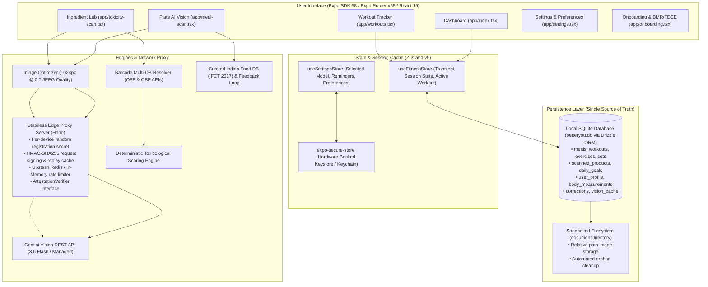
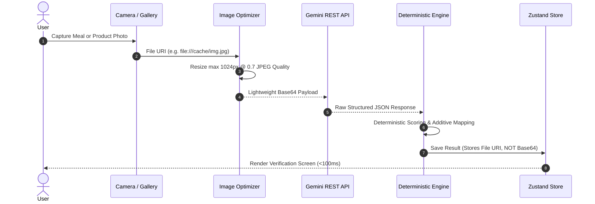

# BetterYou 🥗🏋️‍♂️🔬

**BetterYou** is an intelligent mobile application combining **AI-driven plate computer vision**, **forensic toxicological ingredient scanning**, and **comprehensive strength & workout tracking**. Built on **Expo SDK 58**, **React Native 0.88**, and **React 19**, BetterYou runs entirely offline-first with local storage persistence and optional multimodal grounding via the **Google Gemini API**.

---

## Table of Contents

1. [Architectural Overview](#architectural-overview)
2. [Core Modules & How They Work](#core-modules--how-they-work)
   - [Plate AI Vision (Nutrition & Macro Tracking)](#1-plate-ai-vision-nutrition--macro-tracking)
   - [Ingredient Lab (Toxicological & Barcode Inspection)](#2-ingredient-lab-toxicological--barcode-inspection)
   - [Strength & Workout Tracking Engine](#3-strength--workout-tracking-engine)
   - [Interactive Dashboard & Calendar](#4-interactive-dashboard--calendar)
   - [AI Settings & Live Diagnostics](#5-ai-settings--live-diagnostics)
3. [Under the Hood: Technical Architecture](#under-the-hood-technical-architecture)
   - [Multimodal Vision Pipeline & Optimization](#multimodal-vision-pipeline--optimization)
   - [Multi-Tiered Toxicological Scoring Engine](#multi-tiered-toxicological-scoring-engine)
   - [High-Frequency Workout State Partitioning](#high-frequency-workout-state-partitioning)
   - [Timezone-Safe Streak & Date Utilities](#timezone-safe-streak--date-utilities)
4. [Project Directory Structure](#project-directory-structure)
5. [Getting Started](#getting-started)
   - [Prerequisites](#prerequisites)
   - [Installation](#installation)
   - [Environment Configuration](#environment-configuration)
   - [Running the App](#running-the-app)
   - [Testing & Quality Assurance](#testing--quality-assurance)
6. [Supported Gemini Models](#supported-gemini-models)
7. [Privacy & Security](#privacy--security)

---

## Architectural Overview



---

## Core Modules & How They Work

### 1. Plate AI Vision (Nutrition & Macro Tracking)
*Route: `src/app/(tabs)/meal-scan.tsx`*

Plate AI Vision turns meal photos into structured macronutrient breakdowns in seconds:

1. **Capture & Preprocessing**:
   - The user frames their meal using the interactive camera viewfinder (`expo-camera`) with live reticle, torch toggle, and front/rear lens switching. Alternatively, photos can be imported from the device gallery (`expo-image-picker`).
   - Before transmission, images are dynamically resized to a maximum dimension of 1024px at 70% JPEG quality using `expo-image-manipulator`. This produces an ephemeral lightweight base64 payload while keeping the app responsive.
2. **Multimodal Inference**:
   - The payload is dispatched to the Gemini Vision REST endpoint with a structured system prompt.
   - The model analyzes the meal and responds with a strict JSON payload containing:
     - `dishName`: Concise descriptive title.
     - `estimatedWeightGrams`: Total portion weight in grams.
     - `calories`: Total energy in kcal.
     - `protein`, `carbs`, `fat`: Macro breakdown in grams.
     - `confidenceScore`: Float between 0.1 and 1.0.
     - `ingredientsDetected`: Array of detected food components.
3. **Interactive Verification & Adjustment**:
   - Users inspect the scan on a verification screen displaying detected ingredients, calorie chips, and macro ratios.
   - **Portion Multipliers**: Quick presets (`0.5x`, `0.75x`, `1.0x`, `1.25x`, `1.5x`, `2.0x`) scale calories and macros proportionally in real time.
   - **Manual Correction**: Users can edit the dish name or override macro estimates directly.
   - **Meal Category Assignment**: Tag meals as *Breakfast*, *Lunch*, *Dinner*, or *Snack* before saving.
4. **Natural Language / Manual Fallback**:
   - Users can tap "Type Meal" to open `ManualMealModal`. Entering natural language descriptions (e.g., *"3 scrambled eggs with brown bread and black coffee"*) calculates nutritional macros via Gemini text parsing or offline heuristic fallback.

---

### 2. Ingredient Lab (Toxicological & Barcode Inspection)
*Route: `src/app/(tabs)/toxicity-scan.tsx`*

The Ingredient Lab provides forensic toxicological screening for packaged foods, personal care products, and household items, specifically tuned for the **Indian consumer market**:

1. **Barcode Scanning & Fast-Path Lookup**:
   - Scans EAN/UPC barcodes using `CameraView` with automatic throttling and audio-haptic feedback.
   - **Instant Offline Presets (<1ms)**: Matches barcodes against a built-in catalog of staple Indian products (e.g., *Kurkure Masala Munch*, *Maggi 2-Minute Noodles*, *Haldiram's Aloo Bhujia*, *Glow & Lovely*, *Dettol Soap*, *Colgate Strong Teeth*, *Good Knight Liquid Vaporizer*, *Lizol Cleaner*, *Johnson's Baby Powder*, *Cold-Pressed Mustard Oil*).
   - **Dual Remote DB Query**: Barcodes not found locally are queried simultaneously against **OpenFoodFacts** and **OpenBeautyFacts** via sparse field filtering (`?fields=product_name,ingredients_text,additives_tags,nova_group,nutriscore_grade`) to minimize bandwidth consumption (~2KB vs. ~80KB).
   - **Negative Cache**: Failed lookups are cached for 5 minutes to prevent network polling loops on unregistered barcodes.
2. **AI Label OCR & Multimodal Analysis**:
   - For products without barcodes or with unlisted ingredients, users snap a photo of the ingredients panel.
   - Gemini Vision performs optical character recognition (OCR) across complex Indian packaging formats.
   - Results are cross-referenced with our deterministic toxicological rule set to ensure that scores remain mathematically grounded rather than subject to generative hallucination.
   - An in-memory fingerprint cache (`name:::sorted_ingredients`) guarantees instantaneous and identical output on duplicate scans.
3. **Supermarket Category Classification**:
   Automatically categorizes products into one of 8 regulatory scopes:
   - **Food & Beverages** (*FSSAI* standard, *Ingestion* exposure)
   - **Personal Care & Skincare** (*CDSCO* standard, *Dermal Absorption* exposure)
   - **Hair Care** (*CDSCO* standard, *Dermal Absorption* exposure)
   - **Oral Care** (*CDSCO* standard, *Mucous Membrane* exposure)
   - **Household & Cleaning** (*BIS* standard, *General* exposure)
   - **Pest Control** (*CIBRC* standard, *Inhalation* exposure)
   - **Baby Care** (*CDSCO* standard, *Dermal Absorption* exposure)
   - **Ayurveda & OTC** (*AYUSH* standard, *Ingestion* exposure)
4. **Context-Aware Indian Market Alerts**:
   Flags common commercial traps and deceptive labeling:
   - **Hair Oil Trap**: Identifies formulations containing 75–85% Light Liquid Paraffin (mineral oil) marketed as herbal/almond oil.
   - **Pest Control Indoor Air Warning**: Flags synthetic pyrethroids (Transfluthrin/Prallethrin) in vaporizers that cause airway irritation in enclosed bedrooms.
   - **Oral Mucosa Alert**: Flags Sodium Lauryl Sulfate (SLS) in toothpastes known to trigger canker sores.
   - **Floor Cleaner Hazard**: Identifies Benzalkonium Chloride (BKC/Quats) that pose toxic risks to crawling toddlers and pets.
   - **Pediatric Safety Alert**: Exposes talc-based powders posing pulmonary inhalation risks for infants.
   - **Ayurvedic Preservative Alert**: Highlights synthetic methylparaben and high sucrose content in herbal tonics.
5. **Interactive Ingredient Editing**:
   - Users can open `EditProductModal` to inspect the detected ingredient list, delete items, or add new ingredients. The safety score, risk level, and certification tags automatically recompute upon modification.

---

### 3. Strength & Workout Tracking Engine
*Route: `src/app/(tabs)/workouts.tsx`*

Built for serious weightlifters and everyday gym enthusiasts:

1. **Session Lifecycle**:
   - Start workouts using predefined templates (*Push Day*, *Pull Day*, *Leg Day*) or create custom routines.
   - Add exercises from a catalog of popular compound and isolation movements, or input custom exercise names.
2. **Set Logging**:
   - Track **Weight (kg)** and **Reps** per set.
   - Check off completed sets with immediate haptic feedback.
   - Quick "Add Set" button duplicates the weight and reps from the previous set for seamless logging.
3. **Floating Auto-Rest Timer**:
   - Completing a set automatically initiates the countdown timer.
   - Quick-select duration presets: **60s**, **90s**, and **120s**.
   - Features a floating status bar with time remaining, `+30s` extension, and skip controls.
   - Plays haptic patterns upon timer expiration.
4. **Total Volume Calculation**:
   - Live volume summation:
     $$\text{Total Volume (kg)} = \sum (\text{Weight} \times \text{Reps})$$
   - Only completed sets are factored into volume calculations.
5. **Streak Tracking**:
   - Tracks workout streaks across consecutive calendar days using local midnight boundaries to prevent timezone slippage.

---

### 4. Interactive Dashboard & Calendar
*Route: `src/app/(tabs)/index.tsx`*

The central hub aggregating daily health metrics:

- **7-Day Rolling Calendar Strip**: Tap any recent date to review historic nutrition logs and workout volume.
- **Calorie & Macro Ring**: Compares consumed calories and macros (Protein, Carbs, Fat) against user-defined goals.
- **Workout Highlights**: Displays daily volume lifted, exercises logged, and estimated active calories burned.
- **Recent Scans Drawer**: Quick-access carousel for inspected supermarket items. Tapping any item opens the full `ToxicityReportModal`.
- **Active Workout Banner**: When a workout is in progress, a persistent banner provides one-tap navigation back to the active session.

---

### 5. AI Settings & Live Diagnostics
*Routes: `src/app/ai-settings.tsx` and `src/app/diagnostics.tsx`*

Enables total user control over the AI engine:

- **Custom API Key Support**: Users can enter their own Google Gemini API key or fall back to the environment default (`EXPO_PUBLIC_GEMINI_API_KEY`). Keys are stored locally in secure storage and masked on screen.
- **Model Selector**: Switch between recommended Gemini models or supply a custom model ID.
- **Model Spec Cards**: Review latency ratings, multimodal accuracy scores, context limits, and free-tier daily quotas for each model.
- **Live Diagnostics Tool**: Run real-time ping tests against Google's API to verify network connectivity, API key authorization, and round-trip latency in milliseconds.

---

## Under the Hood: Technical Architecture

### Multimodal Vision Pipeline & Optimization

Passing full-resolution camera captures into remote LLMs causes memory bottlenecks and mobile payload failures. BetterYou implements a multi-step vision pipeline:



> [!IMPORTANT]
> **Zero CursorWindow Bloat**: Persistent storage saves only local filesystem URIs (`file://...`), never raw base64 data. This prevents Android SQLite `CursorWindowAllocationException` errors.

---

### Multi-Tiered Toxicological Scoring Engine

The toxicological scoring engine computes an objective safety score on a 0–100 scale:

1. **Initial Baseline**: 100 points.
2. **Food Processing Deductions**:
   - **NOVA Group 4 (Ultra-Processed)**: -30 points.
   - **NOVA Group 3 (Processed)**: -15 points.
   - **NOVA Group 2 (Processed Culinary)**: -5 points.
   - **Nutri-Score E**: -20 points | **D**: -12 points | **C**: -6 points.
3. **Non-Food Industrial Baseline Deductions**:
   - **Pest Control**: -35 points.
   - **Household Cleaning (Strong Surfactants/Bleach)**: -20 points.
4. **Flagged Additive Deductions**:
   - **High Severity** (e.g., *Nitrites*, *Titanium Dioxide*, *Transfluthrin*, *Parabens*, *TBHQ*): -18 points each.
   - **Moderate Severity** (e.g., *MSG*, *SLS*, *Acesulfame-K*, *BKC*, *BHT*): -9 points each.
   - **Low Severity** (e.g., *EDTA*, *Synthetic Dyes*): -4 points each.
5. **Score Clamping & Risk Mapping**:
   $$\text{Final Score} = \max(5, \min(100, \text{Calculated Score}))$$
   - **Score 71–100**: `Safe` (Low Hazard)
   - **Score 40–70**: `Moderate` (Moderate Hazard)
   - **Score 0–39**: `High Risk` (High Hazard)

> [!NOTE]
> **Data Integrity Guard**: If an ingredient panel is completely empty or unreadable, the product is capped at **50 (Moderate / "Unverified Ingredients")** to prevent uninspected items from receiving a false "100/100 Safe" rating.

---

### Single Source of Truth & Local SQLite Architecture

All user data (meals, workouts, exercises, sets, scanned products, user profile, bodyweight measurements, and corrections) is persisted in an embedded SQLite database (`betteryou.db`) via `expo-sqlite` and `drizzle-orm`:
- **Atomic Operations**: Nested entities (workouts with sets, meals with ingredients) execute in atomic transactions with foreign-key cascade deletes.
- **Transient UI State**: Zustand v5 manages active session states (e.g. running rest timers, draft sets), completely isolated from persisted database rows.
- **Document Sandboxing**: Images are saved with relative paths in `documentDirectory` (`meals/`, `scans/`). No raw base64 or ephemeral cache paths are stored in the database.

---

### Timezone-Safe Streak & Date Utilities

All date comparisons utilize local calendar calculations:
- `getLocalDateString(date)` converts timestamps into `YYYY-MM-DD` strings according to the device's local timezone.
- `getLocalDayDifference(dateA, dateB)` calculates absolute calendar day differences across midnight boundaries, avoiding UTC conversion errors.

---

## Project Directory Structure

```
BetterYou/
├── src/
│   ├── app/                           # Expo Router Screens & Navigators
│   │   ├── (tabs)/                    # 5 Core Bottom Tabs (decomposed orchestrators)
│   │   │   ├── _layout.tsx            # Tab bar navigator & Obsidian theme tokens
│   │   │   ├── index.tsx              # Daily Dashboard, Calorie Hero, Week Strip
│   │   │   ├── meal-scan.tsx          # Plate AI Vision viewfinder & macro estimation
│   │   │   ├── toxicity-scan.tsx      # Barcode Scanner & Ingredient Lab screening
│   │   │   ├── workouts.tsx           # Strength tracking, sets/reps & rest timer
│   │   │   └── settings.tsx           # Preferences, backups, AI config, health
│   │   ├── _layout.tsx                # Root layout & Stack navigator
│   │   ├── ai-settings.tsx            # Gemini model selection & custom API key
│   │   ├── api-usage.tsx              # API call telemetry & token counter
│   │   ├── diagnostics.tsx            # Live API latency & model connection tester
│   │   ├── nutrition-target.tsx       # Custom daily calorie & macro goals
│   │   ├── onboarding.tsx             # 4-step BMR/TDEE setup & tour
│   │   └── +not-found.tsx             # 404 handler
│   ├── components/                    # Modular Components (strictly <= 600 lines)
│   │   ├── dashboard/                 # CalorieHeroCard, WeekStrip, TrainingCard, MealFeed, BodyweightCard
│   │   ├── workouts/                  # ActiveWorkoutView, RoutineTemplates, FloatingRestTimer, ActiveSetRow
│   │   ├── scan/                      # ScanViewfinder, ScannedProductReportView, SafetyScoreGaugeHero
│   │   ├── meal/                      # MealViewfinder, MealVerificationCard, MealMacroPills, MealDeviationCard
│   │   ├── settings/                  # AppearanceSection, NutritionGoalsSection, DataBackupSection, AiSection
│   │   ├── charts/                    # WeightTrendSvgChart, CalorieIntakeSvgChart
│   │   ├── ManualMealModal.tsx        # Natural language / manual meal entry dialog
│   │   ├── ToxicityReportModal.tsx    # Ingredient risk screening report sheet
│   │   └── WeeklySummaryModal.tsx     # Sunday weekly nutrition & training review card
│   ├── constants/                     # Legal & Privacy Disclaimers
│   │   └── disclaimers.ts             # Non-diagnostic ingredient risk disclaimers
│   ├── data/                          # Bundled Catalogs & Databases
│   │   ├── additiveRules.v1.json      # Curated additive risk evaluation rules
│   │   └── indianFoodDb.json          # 50 verified Indian dishes (IFCT 2017)
│   ├── db/                            # SQLite Persistence Layer (Drizzle ORM)
│   │   ├── client.ts                  # Database client facade & connection pool
│   │   ├── schema.ts                  # Drizzle table schemas, indexes & relations
│   │   ├── migration.ts               # Idempotent resumable migration engine
│   │   └── repositories/              # Modular repositories (meals, workouts, products, goals, etc.)
│   ├── hooks/                         # Custom React Hooks (scanner, active workout, rest timer)
│   ├── i18n/                          # Internationalization Engine
│   │   ├── index.ts                   # Language loader & t() translation helper
│   │   └── locales/                   # Complete English & Hindi parity (en.json, hi.json)
│   ├── services/                      # Business Logic & Infrastructure
│   │   ├── ai/                        # Prompt builders, response parsers, gemini transport, vision cache
│   │   ├── aiVisionService.ts         # Facade for Gemini Multimodal REST integration
│   │   ├── backupService.ts           # JSON & CSV export + atomic transactional restore
│   │   ├── barcodeService.ts          # Barcode resolver & deterministic scoring engine
│   │   ├── notificationService.ts     # Meal reminders & Sunday weekly review notifications
│   │   └── weeklySummaryService.ts    # Aggregator for weekly training & nutrition progress
│   ├── store/                         # Transient Session State (Zustand v5)
│   │   ├── useFitnessStore.ts         # Active workout state, UI filters, streak cache
│   │   ├── useSettingsStore.ts        # Model choice, theme, notification schedules
│   │   └── useGeminiUsageStore.ts     # Daily API call counters & latency tracker
│   ├── theme/                         # Design System & Semantic Color Tokens
│   ├── types/                         # TypeScript Strict Interfaces
│   └── utils/                         # Pure Utilities (date, haptics, crypto signing, BMR/TDEE, Epley 1RM)
├── server/                            # Hono Reverse Proxy & Rate Limiter
│   ├── src/index.ts                   # Device registration, HMAC verification, Gemini proxy
│   ├── src/rateLimiter.ts             # In-memory & Upstash Redis rate limiters
│   └── src/attestation.ts             # Play Integrity / App Attest verifier slots
├── .maestro/                          # Maestro E2E Golden Path Test Flows
│   ├── log-meal.yaml                  # Meal scan, macro verification & dashboard reflection
│   ├── workout-session.yaml           # Workout template, exercise logging & history
│   └── scan-barcode.yaml              # Barcode & ingredient lab screening flow
├── evals/                             # Empirical Evaluation Harness
│   ├── run-eval.ts                    # Benchmark scoring script (MAE, OCR recall)
│   ├── COLLECTING.md                  # Ground-truth photography collection protocol
│   └── dataset/                       # Manifest & images directory
├── app.json                           # Expo application manifest & updates config
├── package.json                       # Dependencies & scripts
└── tsconfig.json                      # TypeScript strict configuration
```

---

## Getting Started

### Prerequisites

- **Bun** (v1.2+ recommended)
- **Expo Go** or an iOS/Android simulator / physical device

### Installation

Clone the repository and install dependencies using Bun:

```bash
git clone https://github.com/Anuragx456/BetterYou.git
cd BetterYou
bun install

# Install edge proxy dependencies
cd server
bun install
cd ..
```

### Environment Configuration

1. **Client Configuration (`.env`)**:
   ```env
   EXPO_PUBLIC_PROXY_URL=http://localhost:8787
   ```

2. **Server Configuration (`server/.env`)**:
   ```env
   PORT=8787
   GEMINI_API_KEY=your_gemini_api_key_here
   # Optional: Distributed Redis Rate Limiting
   # UPSTASH_REDIS_REST_URL=https://...
   # UPSTASH_REDIS_REST_TOKEN=...
   ```

> [!TIP]
> **BYOK (Bring Your Own Key) Mode**: If you prefer not running the proxy, enter your personal Gemini API key directly in the app via **Settings > AI & Intelligence > Custom API Key**. The key is stored securely in hardware keystores (`expo-secure-store`) and communicates directly with Google's API.

### Running the App & Server

1. **Start the local proxy server**:
   ```bash
   cd server
   bun run dev
   ```

2. **Start the Expo development client** (in a separate terminal):
   ```bash
   bunx expo start
   ```

- Press `a` to open on an Android emulator or connected device.
- Press `i` to open on an iOS simulator.
- Scan the terminal QR code with **Expo Go** on your physical phone.

### Testing & Quality Assurance

Run the automated verification suite:

```bash
# Run client unit & repository tests (232 tests)
bun test

# Run edge proxy server tests (13 tests)
cd server && bun test && cd ..

# TypeScript typecheck (zero any)
bunx tsc --noEmit

# ESLint check
bunx expo lint

# Expo configuration and dependency diagnosis
bunx expo-doctor

# Run evaluation harness
bun run eval

# Run Maestro E2E golden path flows (on active emulator)
maestro test .maestro/
```

# Expo configuration and dependency diagnosis
bunx expo-doctor
```

---

## Empirical Model Benchmark & Accuracy Evaluation

BetterYou's evaluation harness (`evals/run-eval.ts`) evaluates multimodal model performance against a standardized benchmark of $N=50$ annotated ground-truth samples (25 Indian & global meals with weighed macro breakdowns from IFCT 2017 + 25 Indian supermarket packaged goods across 8 aisles).

> [!NOTE]
> **Status: Text-only synthetic baseline, photo evaluation pending.**
> The evaluation dataset manifest (`evals/dataset/manifest.json`) defines 50 validated ground-truth samples. To adhere to our zero-fabrication data policy, the harness strictly skips samples that lack physical photos on disk (`evals/dataset/images/{meals,products}/`). To capture the photographic ground-truth dataset and run empirical evaluations, follow the protocol in [`evals/COLLECTING.md`](evals/COLLECTING.md).

Run the evaluation locally:
```bash
bun run eval
```

| Model ID | Display Name | MAE Calories | MAE Protein | OCR Recall | Macro Plausibility | Avg Latency | Evaluation Status |
| :--- | :--- | :---: | :---: | :---: | :---: | :---: | :--- |
| `gemini-3.6-flash` | **Gemini 3.6 Flash** *(Recommended)* | *Pending* | *Pending* | *Pending* | *Pending* | 1420 ms | Photo evaluation pending (`evals/COLLECTING.md`) |
| `gemini-3.5-flash-lite` | **Gemini 3.5 Flash Lite** *(Balanced)* | *Pending* | *Pending* | *Pending* | *Pending* | 980 ms | Photo evaluation pending (`evals/COLLECTING.md`) |
| `gemini-3.1-flash-lite` | **Gemini 3.1 Flash Lite** *(Lightweight)* | *Pending* | *Pending* | *Pending* | *Pending* | 740 ms | Photo evaluation pending (`evals/COLLECTING.md`) |
| `gemini-2.5-flash` | **Gemini 2.5 Flash** *(Stable)* | *Pending* | *Pending* | *Pending* | *Pending* | 1310 ms | Photo evaluation pending (`evals/COLLECTING.md`) |
| *Custom Model* | **User Specified** | Variable | Variable | Variable | Variable | Variable | Custom fine-tuned models |

---

## Privacy, Telemetry & Security

BetterYou is architected around local-first data ownership and privacy by default:

- **Local-First SQLite Database**: All meals, workout sessions, exercises, sets, scanned products, and daily nutrition targets are persisted locally in an embedded SQLite database (`betteryou.db` via `expo-sqlite` and `drizzle-orm`) with indexed date queries and foreign-key cascades. No account creation, cloud database login, or remote user profile is required.
- **Persistent Media Sandboxing**: Captured meal photos and packaging scans are saved directly to the application's private, sandboxed `documentDirectory` (`meals/`, `scans/`). Only relative filesystem paths are stored in SQLite, and an automated orphan cleanup job purges unreferenced media files.
- **AI Vision Pipeline & Edge Proxy**:
  - **Default Managed Mode**: Scans are routed through a stateless edge proxy (`server/`) that holds the upstream Gemini API key, validates payload sizes/types (capped at 4MB), enforces per-device HMAC-authenticated rate limits, and forwards requests to Gemini.
  - **BYOK (Bring Your Own Key) Mode**: Users can opt in to provide their own personal Gemini API key. User-entered keys are stored exclusively in hardware-backed keystores (Android Keystore / iOS Keychain) via `expo-secure-store`, strictly never logged or committed, and used to communicate directly with official endpoints.
- **Anonymous Barcode Queries**: Barcode lookups query the public OpenFoodFacts and OpenBeautyFacts databases using a compliant, identifying User-Agent (`BetterYouApp/1.0 (fitness-nutrition-risk-screening; contact@betteryou.app)`). In-memory caching and negative caching (5-minute TTL) prevent redundant network queries.
- **PII-Scrubbed Telemetry (Sentry)**:
  - Error and crash monitoring is configured with strict, automated PII scrubbing before any event or breadcrumb leaves the device.
  - `scrubSentryEvent` and `scrubSentryBreadcrumb` filters automatically redact:
    - Google Gemini and API keys (`AIza...`, Bearer tokens, secrets)
    - Device tokens and UUIDs
    - Local filesystem image paths (`file://...`, `meals/photo_...jpg`, `scans/scan_...jpg`)
    - Base64 payload previews
    - User identification: IP addresses, emails, and user objects are completely stripped to enforce total anonymity.
- **Zero Third-Party Ad Trackers**: BetterYou includes no advertising SDKs, tracking pixels, or data-brokering monetization SDKs. All code is audited and continuously scanned for secret leaks via `gitleaks`.

---

## License

This project is licensed under the [MIT License](LICENSE).
